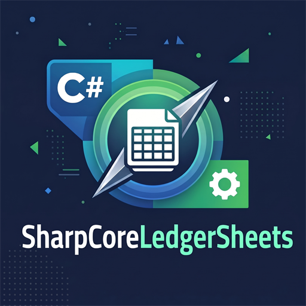

<div align="center">



# SharpCoreLedgerSheets

**The three core financial statements — balance sheet, profit & loss and cash flow — for the Dutch
MKB and small businesses anywhere, in one small, dependency-light .NET package.**

[](https://github.com/MPCoreDeveloper/SharpCoreLedgerSheets/actions/workflows/ci.yml)
[](LICENSE)
[](https://dotnet.microsoft.com/download)
[](https://learn.microsoft.com/dotnet/csharp/)

</div>

SharpCoreLedgerSheets is an embedded accounting engine and web application built on
[SharpCoreDB](https://github.com/MPCoreDeveloper/SharpCoreDB): a double-entry ledger is the single
source of truth, and every statement plus the key ratios are derived from it. Data is stored in a
single encrypted `.scdb` file that never leaves your machine.

> **Dutch first, international by design.** The interface, the number and date formatting and the
> report labels are Dutch out of the box — `nl` is the default culture, because the target market is
> the Dutch MKB — and switchable per user to English, German, French, Spanish, Italian, Portuguese or
> Polish. The code, the API and the database schema are English, so a contributor never needs Dutch
> to work on the engine.

---


## Why

Small entrepreneurs and consumers rarely need a full ERP. They need to answer three questions — and
have them stay consistent with each other:

1. **What do I own and owe?** — the balance sheet (*balans*)
2. **Did I make a profit?** — the profit and loss statement (*winst- en verliesrekening*)
3. **Where did my cash go?** — the cash flow statement (*kasstroomoverzicht*)

SharpCoreLedgerSheets answers those from **one** double-entry ledger. The statements cannot drift apart
because they are three views of the same journal entries, and the engine asserts that they
reconcile (assets = liabilities + equity, and opening cash + movement = closing cash).

## Highlights

- **Double-entry, enforced.** Journal entries must balance; a line is either debit or credit, never
  both. Invalid entries are rejected with a clear domain exception.
- **Three statements + ratios** derived from the ledger: current ratio, quick ratio, solvency, net
  profit margin and return on equity.
- **Reconciliation is asserted**, not assumed: the balance sheet balances and the cash flow
  statement ties opening to closing cash.
- **Encrypted, embedded storage** via SharpCoreDB — one file, no server to run.
- **Reports** rendered from Razor templates into self-contained, print-ready HTML, plus CSV export
  for spreadsheets.
- **Localized** in Dutch (default), English, German, French, Spanish, Italian, Portuguese and
  Polish — report labels come from `IReportLabels`, so templates stay language-neutral.
- **Rule messages in the user's language** — every user-triggerable rule carries a `MessageCode`, so a
  rejected entry is explained in the language of the interface, not only in Dutch.
- **Correct books for the Dutch MKB** — a book year that starts in any month, opening balances entered once
  and posted as a real journal entry, and VAT (21% / 9% / 0%) booked to per-rate accounts with a quarterly
  return.
- **Bank statements come in as they are** — CAMT.053 (XML) or CSV, with a matching assistant that
  proposes a counterparty account per movement and learns from the bookings you confirm.
- **Architecture tests** guard the layering, and the build is warning-free under the Microsoft and
  Sonar analyzers.

## Architecture

```text
SharpCoreLedgerSheets.Web                 ASP.NET Core (Razor Pages) + localization
  +-- SharpCoreLedgerSheets.Reports        Razor report templates, registry, CSV export
  +-- SharpCoreLedgerSheets.Infrastructure SharpCoreDB repositories + CAMT.053/CSV readers
  +-- SharpCoreLedgerSheets.Application    use cases: account/entry/reporting/bank-import services
        +-- SharpCoreLedgerSheets.Domain   ledger, statements, ratios - no dependencies at all
```

Dependencies point inwards only. `SharpCoreLedgerSheets.Domain` has **zero** package references: the
bookkeeping rules, the three statements and the ratios are pure, deterministic and fully unit
tested. `Application` defines the storage ports, `Infrastructure` implements them with SharpCoreDB
and reads the bank statement formats, `Reports` renders, and `Web` composes.


### Domain model

| Concept | Type | Notes |
| --- | --- | --- |
| Currency | `Currency` | ISO-4217, drives the decimals of every amount |
| Money | `Amount` | Rounds to the currency's decimals; refuses mixed-currency arithmetic |
| Period | `Period` | Inclusive date range, for example `Period.ForYear(2026)` |
| Account | `Account` | Assets, liabilities, equity, revenue, expenses + classification flags |
| Entry | `JournalEntry` / `JournalEntryLine` | Balanced debit/credit lines |
| Ledger | `Ledger` | Accounts plus entries; the single source of truth |
| Statements | `BalanceSheet`, `ProfitAndLoss`, `CashFlowStatement`, `RatioOverview` | Immutable results |
| Builders | `BalanceSheetBuilder`, `ProfitAndLossBuilder`, `CashFlowBuilder`, `RatioCalculator` | Pure domain services |
| Bank movement | `BankTransaction` | Signed movement with the bank's reference; account + reference form the import key |
| Matching rule | `CounterAccountRule` | Keyword → counterparty account, learned from a confirmed booking |
| Proposal | `PostingProposal` | Suggested counterparty account with a certainty (0-100) and the reason |

Cash flow classification is derived, not configured: an entry touching a cash account is
*operating* when its counterpart is revenue or an expense, *investing* when the counterpart is a
non-cash asset, and *financing* when the counterpart is a liability or equity.

### Storage schema

The schema is **English**, so the data model reads the same for every contributor and for anyone who
opens the file with a SharpCoreDB tool. Table, column and index names are short on purpose:
SharpCoreDB derives metadata block names from them and caps a block name at 31 characters.

| Table | Purpose | Columns |
| --- | --- | --- |
| `accounts` | Chart of accounts | `id`, `number`, `name`, `type`, `is_active`, `is_current`, `is_cash_equivalent`, `is_inventory` |
| `entries` | Journal entries | `id`, `date`, `description`, `reference` |
| `entry_lines` | Entry lines | `id`, `entry_id`, `sequence`, `account_id`, `debit`, `credit`, `description` |
| `banktxns` | Imported bank transactions | `id`, `bank_account`, `date`, `amount`, `currency`, `reference`, `counterparty`, `iban`, `description`, `status`, `entry_id` |
| `matchrules` | Learned matching rules | `keyword`, `counter_account`, `confirmations` |

Amounts are `DECIMAL`, dates are ISO-8601 `yyyy-MM-dd` text so they sort chronologically, and schema
creation is idempotent (`IF NOT EXISTS`), so it runs safely on every start-up.

### Starter chart of accounts

A new administration can start from a complete chart instead of an empty page: open **Accounts**, pick
**Nederlands MKB (RGS)** or **International (English)** and load it. Both charts carry the same 29 accounts
with the same numbering - 1xxx liquid assets, 2xxx current liabilities, 3xxx long-term debt, 4xxx equity,
7xxx costs, 8xxx revenue - so only the names change with the market:

| Number | Dutch MKB | International | Type |
| --- | --- | --- | --- |
| 1000 | Kas *(current, cash)* | Cash *(current, cash)* | Assets |
| 1100 | Bank *(current, cash)* | Bank *(current, cash)* | Assets |
| 1400 | Voorraad *(inventory)* | Inventory *(inventory)* | Assets |
| 2000 | Crediteuren | Trade payables | Liabilities |
| 2100 | Te betalen btw 21% | VAT payable 21% | Liabilities |
| 2101 | Te betalen btw 9% | VAT payable 9% | Liabilities |
| 1110 | Te vorderen btw 21% | VAT receivable 21% | Assets |
| 1111 | Te vorderen btw 9% | VAT receivable 9% | Assets |
| 4000 | Eigen vermogen | Equity | Equity |
| 8000 | Omzet | Revenue | Revenue |
| 7000 | Inkoopwaarde van de omzet | Cost of goods sold | Costs |

Loading is additive and idempotent: numbers that already exist are never renamed or deactivated, so the
button is safe on a half-filled administration (`IAccountService.ApplyStarterChartAsync`).

### Book year and opening balances

**Settings** (Instellingen) holds the administration itself: the company name - shown on reports - and the
month the book year starts in. A book year that runs from 1 April is start month 4, and every statement
follows it: the dashboard, the journal, the reports and the VAT return.

**Opening balances** (Beginsaldi) are entered per account for a book year. LedgerSheets posts them as one
balanced entry dated the day before the book year starts, with the reserved reference `OPENING-<year>`:

| Date | Reference | Account | Debit | Credit |
| --- | --- | --- | --- | --- |
| 2025-12-31 | OPENING-2026 | 1000 Kas | 2 500,00 | |
| 2025-12-31 | OPENING-2026 | 4000 Eigen vermogen | | 2 500,00 |

Because the opening position is a real journal entry, the balance sheet balances from day one, the cash flow
statement opens with the right cash, and the position is visible and auditable in the journal. Saving again
replaces it, an empty set removes it, and lines that do not balance are refused with both totals in the message.

### VAT (btw)

**VAT** (Btw) shows the return of the administration per quarter or for the whole book year: per rate what is
owed on sales (*af te dragen btw*), what is reclaimable on purchases (*voorbelasting*), and the amount to pay or
to receive. The figures are read straight from the VAT accounts, so the return always agrees with the ledger.

Booking is a form on **Journal**: choose sale or purchase, the net amount, the rate and the two accounts.
LedgerSheets composes the balanced entry - net to the revenue or cost account, VAT to the rate's account, gross
to the customer or supplier:

```text
Sale    100,00 net at 21%  ->  Debit 1300 Debiteuren  121,00
                               Credit 8000 Omzet      100,00
                               Credit 2100 Btw 21%     21,00

Purchase 100,00 net at 9%  ->  Debit 7000 Inkoop      100,00
                               Debit 1110 Btw 9%        9,00
                               Credit 2000 Crediteuren 109,00
```

The 0% rate books no VAT line, and VAT is rounded per line to cents, half away from zero.

> **Scope.** The return reports the VAT per rate - the amount a business pays. The turnover lines of the Dutch
> form (1a / 1b / 1e) need invoice-level data and arrive with the invoice milestone.


## Quick start

```bash
git clone https://github.com/MPCoreDeveloper/SharpCoreLedgerSheets.git
cd SharpCoreLedgerSheets
dotnet build SharpCoreLedgerSheets.slnx
dotnet test  SharpCoreLedgerSheets.slnx
```

Run the web app (the database is encrypted, so it needs a master password):

```bash
cd src/SharpCoreLedgerSheets.Web
dotnet user-secrets init
dotnet user-secrets set "SharpCoreLedgerSheets:Storage:MasterPassword" "choose-a-strong-password"
dotnet run
```

Then open the dashboard, add accounts under **Accounts**, post entries under **Journal**, import
a bank statement under **Bank import** and view the statements under **Report**.

> The master password can also be supplied through the environment variable
> `SharpCoreLedgerSheets__Storage__MasterPassword`. **Losing it means losing the data** — SharpCoreLedgerSheets never
> stores it anywhere.

### Using the engine as a library

```csharp
using SharpCoreLedgerSheets.Domain.Accounting;
using SharpCoreLedgerSheets.Domain.Services;

var ledger = new Ledger();

var cash    = ledger.AddAccount("1000", "Cash", AccountType.Assets, isCurrent: true, isCashEquivalent: true);
var revenue = ledger.AddAccount("8000", "Revenue", AccountType.Revenue);

ledger.Post(JournalEntry.New(new DateOnly(2026, 6, 15), "Cash sale")
    .Debit(cash.Id, 250m)
    .Credit(revenue.Id, 250m));

var period  = Period.ForYear(2026);
var balance = new BalanceSheetBuilder().BuildOn(ledger, period.Closing);
var ratio   = new RatioCalculator().Calculate(balance, new ProfitAndLossBuilder().BuildOn(ledger, period));

Console.WriteLine($"Assets: {balance.TotalAssets:N2} (balanced: {balance.IsBalanced})");
Console.WriteLine($"Current ratio: {ratio.CurrentRatio:N2}");
```

## Reports

| Report | Template | Contents |
| --- | --- | --- |
| Financial overview | `FinancialOverviewReport` | All three statements plus the ratios in one document |
| Balance sheet | `BalanceSheetReport` | Assets, liabilities, equity and the balance check |
| Profit & loss | `ProfitAndLossReport` | Revenue, expenses and the result |
| Cash flow | `CashFlowReport` | Operating, investing and financing activities with the reconciliation |

Reports are resolved through `ReportRegistry`, rendered by `IReportRenderer` and exported with
`IReportExporter` (RFC 4180 CSV, invariant numbers, ready for any spreadsheet).

The rendered HTML is deliberately **self-contained**: styling is embedded, there is **no JavaScript** and no
CDN, and the brand mark travels inside the document as a `data:` URI - so a report prints to PDF as a single
file, offline, with the logo in place. Print it (or use the *Print* link in the web app) to get a PDF from
the browser — which avoids shipping a headless browser inside a small package. Register a custom
`IReportRenderer` if you need server-side PDF generation.

## Bank import

Import a bank statement under **Bank import**: choose the ledger account it belongs to, upload a
CAMT.053 (XML) or CSV file, and SharpCoreLedgerSheets reads it. The reader follows the format rather than the
bank: XML elements are matched on their local name (so every CAMT.053 version and namespace works)
and CSV columns are recognised by their header names, with the delimiter and the number notation
detected. Only **booked** movements are read — a pending movement can still change.

The matching assistant then proposes a counterparty account per movement and says why: an IBAN you
booked before counts as certain (100), a keyword you confirmed scores 90, and an account whose name
or number appears in the movement scores 70. From 90 the proposal is pre-selected; below that it is
shown as a hint. Confirmations are remembered as rules, so the same counterparty is recognised next
month — the assistant never invents a rule on its own. All proposals are built in one pass: the
ledger and the learned rules are read once per page, however many movements the statement holds.

Importing is **idempotent**: a movement is identified by the bank account plus the bank's own
reference, so re-importing the same statement adds nothing. When a bank supplies no reference at all,
SharpCoreLedgerSheets derives one from the content of the movement (`SYN-…`); two movements that share their
date, amount, currency and text then count as one.

## Localization

**Dutch is the default** — the target market is the Dutch MKB, so a Dutch entrepreneur gets a Dutch
application, Dutch number and date formatting (`1.234,56`, `31-12-2026`) and Dutch report labels
without configuring anything. English is the neutral fallback: `SharedResource.resx` holds the English
text and covers any key a translation is missing, so an international user is never stranded.
Translations ship for `nl`, `en`, `de`, `fr`, `es`, `it`, `pt` and `pl` in
`src/SharpCoreLedgerSheets.Web/Resources/SharedResource.*.resx`.

Switch language in the web app (top right) or with `?culture=de`; the choice is remembered in a
cookie, and a browser that asks for another language gets it. A host that serves a different market
moves the default without touching code:

```json
{ "SharpCoreLedgerSheets": { "Localization": { "DefaultCulture": "en" } } }
```

Adding a language means adding one `.resx` file and one entry in `Languages.Supported` — the
localization tests then verify that every key is present.

> **Message catalogue.** Interface labels and rule messages are both translated. A rule raises a
> `MessageCode`; the web layer resolves `Msg_<code>` for the request culture and falls back to the Dutch
> message the engine carries when a culture has no translation. Dutch and English are complete - German,
> French, Spanish, Italian, Portuguese and Polish show English *messages* until they are translated, while
> their interface is already translated.


## Testing

```bash
dotnet test SharpCoreLedgerSheets.slnx
```

| Suite | Focus |
| --- | --- |
| `SharpCoreLedgerSheets.Domain.Tests` | Value objects, ledger invariants, statement maths, ratios, bank movements and matching |
| `SharpCoreLedgerSheets.Application.Tests` | Use cases against in-memory repositories |
| `SharpCoreLedgerSheets.Infrastructure.Tests` | Real encrypted SharpCoreDB round-trips, reopen durability and the CAMT.053/CSV readers |
| `SharpCoreLedgerSheets.Reports.Tests` | Report registry, CSV export and full Razor rendering |
| `SharpCoreLedgerSheets.ArchitectureTests` | Layer dependencies, naming and localization completeness |

## Mutation testing

The suite proves the code does what the tests say; mutation testing proves the other direction — that the
tests would *notice* when the code is wrong. [Stryker.NET](https://stryker-mutator.io) is pinned in
`.config/dotnet-tools.json` (so it restores with the repository) and configured per test project in
`stryker-config.json`:

```bash
dotnet tool restore
cd tests/SharpCoreLedgerSheets.Domain.Tests
dotnet stryker                          # full run of the domain
dotnet stryker --mutate "Accounting/Amount.cs"   # scope it while iterating
```

| Project | Mutated code | Why |
| --- | --- | --- |
| `Domain.Tests` | `SharpCoreLedgerSheets.Domain` | The accounting rules: a surviving mutant here is a bug the suite would not catch |
| `Application.Tests` | `SharpCoreLedgerSheets.Application` | Use cases: account/entry/reporting/bank-import rules |
| `Reports.Tests` | `Services/`, `Models/`, `Reporting/` | Registry, rendering and CSV export |
| `Infrastructure.Tests` | `Banking/` | The CAMT.053/CSV readers (opt-in: the storage tests spin up real databases) |

Reports land in `StrykerOutput/<timestamp>/reports/` as HTML and JSON (`domain-mutation-report.html`).
`.github/workflows/mutation.yml` runs the three main projects every Monday and on demand, uploading the
reports as artifacts.

Three deliberate configuration choices:

- **`"test-runner": "mtp"`** — the test projects are xunit.v3 on Microsoft.Testing.Platform. With the
  default VSTest runner Stryker's coverage analysis mapped no tests to mutants, so everything "survived";
  with MTP the mapping works and the score is real.
- **`ignore-mutations: ["string"]`** — mutating user-facing message text says nothing about behaviour, and
  this project has a whole message catalogue.
- **`thresholds.break = 0`** — the score is a diagnostic, not a gate. Raise it once the baseline is stable
  enough to defend.

## Requirements

- .NET SDK **11.0** (pinned in `global.json`; the solution targets `net11.0` / C# 15)
- No database server, no Node.js, no design-time tooling

## Upgrading from LedgerSheets 1.0

2.0 is the rebrand of **LedgerSheets** to **SharpCoreLedgerSheets**, and it renames the database schema
from Dutch to English (`rekeningen` → `accounts`, `posten` → `entries`, `postregels` → `entry_lines`,
`bankmutaties` → `banktxns`, `matchregels` → `matchrules`, together with every column and index). There
is no in-place migration: start a new file and re-import, or stay on the 1.0 package for the existing
data. Also renamed: the configuration section (`LedgerSheets:Storage` →
`SharpCoreLedgerSheets:Storage`), the environment-variable prefix
(`SharpCoreLedgerSheets__Storage__MasterPassword`), the assemblies and the NuGet package IDs. The
default UI culture is now Dutch instead of English.

## Contributing

See [CONTRIBUTING.md](CONTRIBUTING.md). The decisions behind the code are recorded with
[Spec Kit](https://github.com/github/spec-kit): the principles live in
[`.specify/memory/constitution.md`](.specify/memory/constitution.md), and every change keeps its own
specification, technical plan, tasks and research under [`specs/`](specs/) — the product itself (001), the
rebrand (002), localized messages and the starter chart (003), mutation testing (004) and the book year,
opening balances and VAT (005).

## License

[MIT](LICENSE) © MPCoreDeveloper

